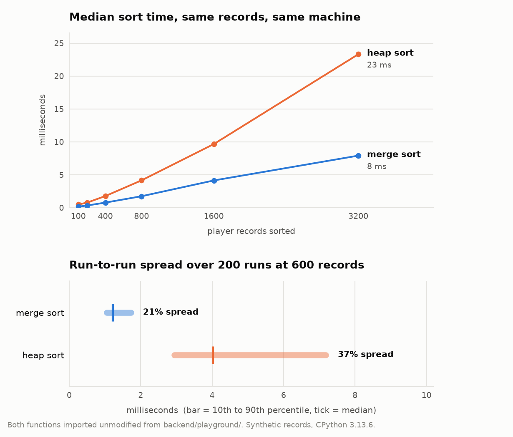

# Hoopalytics

**Two sorting algorithms, written from scratch, racing each other over a season of NBA box scores.**

Pick a statistic. The backend ranks every player by it twice, once with a hand-written
merge sort and once with a hand-written heap sort, times both, and hands back the top ten
plus the two timings. The front end shows the leaderboard and who won the race.

Built with a three-person team.

---

## How it works

```
data/archive/PlayerStatistics.csv      a season of raw box scores, one row per player-game
            |
            |  pandas: filter to the current season, group by player,
            |  average the per-game stats, derive FG% / 3P% / FT%
            v
     list[dict], one entry per player
            |
            +---> merge_sort(players, key, reverse)   timed
            +---> heap_sort(players, key, reverse)    timed
            |
            v
   JSON: top 10 from each sort + both timings
            |
            v
   React table, with the two timings shown above it
```

Both sorts are in `backend/playground/`, written out in full rather than handed to
`sorted()`. They take the ranking key as a parameter, so the same code ranks by points,
assists, rebounds, steals, blocks, or plus-minus without changing the comparator:

- `mergesort.py` splits the list, recurses, and merges the two halves back together
  comparing on `player[key]`.
- `heapsort.py` builds a max-heap bottom-up from the last non-leaf node, then repeatedly
  swaps the root to the end and re-heapifies the shrinking prefix.

`formulaCalculate.py` holds the other half of the idea: a weighted metric where you supply
your own coefficients and get a single score per player, so you can define what "best"
means instead of accepting one stat at a time.

## How the two sorts actually compare

Both are O(n log n), so the interesting question is what the constants look like once
they are real Python working on dictionaries rather than pseudocode on integers.

<picture>
  <source media="(prefers-color-scheme: dark)" srcset="assets/sort-benchmark-dark.png">
  
</picture>

Merge sort wins on both counts here: it is consistently faster, and its run-to-run
timing is tighter, which is what you want if you are going to show a number to a user on
every request. Heap sort pays for its in-place swapping with far more pointer-chasing
through the dict objects.

*(Benchmark run with the two functions imported unmodified from `backend/playground/`,
over synthetic player records, since the real dataset is not committed. Your numbers will
differ; the ordering is the point.)*

## Running it

The dataset is **not** in this repo. It comes from a public Kaggle dataset of historical
NBA box scores, and `update_data.sh` fetches it:

```bash
# 1. data (needs the kaggle CLI and a Kaggle API token)
./update_data.sh          # downloads into data/archive/

# 2. backend
cd backend
python manage.py runserver        # serves JSON on http://127.0.0.1:8000/

# 3. front end, in a second terminal, from the repo root
npm install
npm run dev                       # http://localhost:5173/
```

The front end requests `http://127.0.0.1:8000/?stat=PPG`, so the backend has to be running
on that exact port or the table shows its error state.

## Built with

`Python` · `Django` · `pandas` · `React` · `Vite` · `Tailwind CSS`

## The tricky parts

- **Making one sort serve six rankings.** The first version sorted a flat list of numbers,
  which is easy and useless: you lose track of which player each number belongs to. Both
  sorts had to move to sorting a list of records by a key chosen at request time, which is
  what makes the comparator a parameter rather than a hard-coded `<`.
- **Timing something fast enough to be noise.** At a few hundred players, both sorts finish
  in single-digit milliseconds, and the gap between two runs of the *same* sort can be
  larger than the gap between the two algorithms. That is why the benchmark above reports a
  median over many runs and shows the spread, rather than a single stopwatch reading.
- **Getting the season boundary right.** Box scores are per game, not per season, so the
  averages depend entirely on filtering to the right date range first, then grouping. The
  percentage stats (FG%, 3P%, FT%) have to be computed from summed makes and attempts
  across the season, not by averaging per-game percentages, which quietly gives the wrong
  answer.
